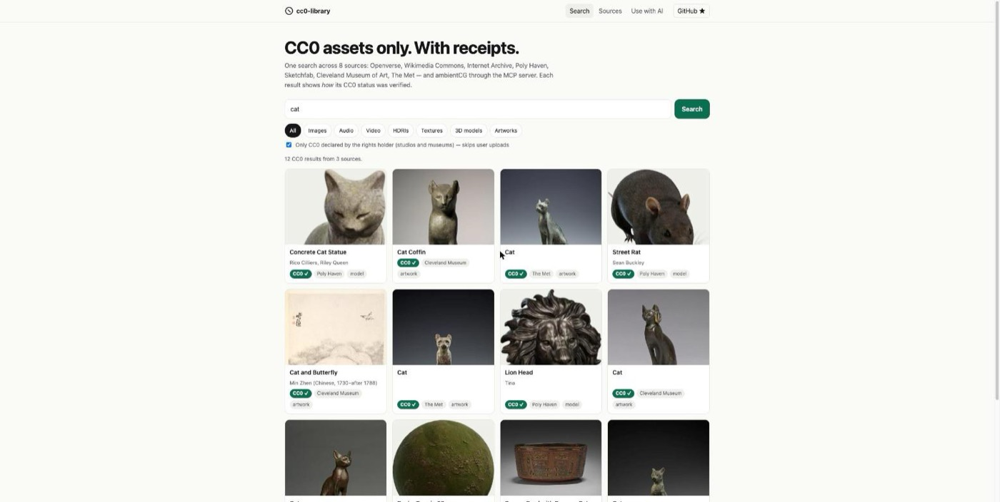
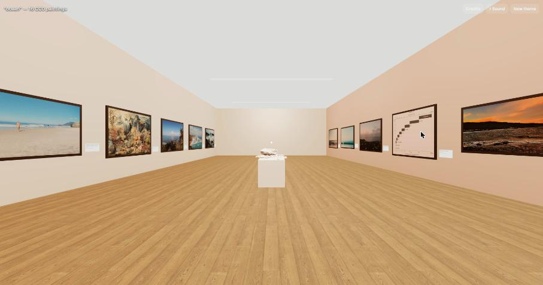

# cc0-library

**CC0 assets only. With receipts.**
One search across **17 sources** for images, audio, video, HDRIs, textures, 3D models, museum artworks and whole asset collections, plus a hand-verified catalog of **681 CC0 sources**. Every result shows *how* its CC0 status was verified and *who* declared it.

[](https://github.com/sanghyoLe/cc0-library/actions/workflows/ci.yml)


[](https://www.npmjs.com/package/cc0-library-mcp)
[](https://glama.ai/mcp/servers/sanghyoLe/cc0-library)
[](https://mcprush.com/to/cc0-library-mcp?ref=badge)

- **Try it in the browser:** https://sanghyole.github.io/cc0-library/ — browse shelves of museum paintings, wildlife photos, HDRIs, textures, 3D models, sounds, icons and datasets, or search all sources
- **Walk through the CC0 Museum:** https://sanghyole.github.io/cc0-library/museum.html — a 3D gallery generated from CC0 assets for any theme
- **Use it from Claude, Cursor, or any MCP client:** `claude mcp add cc0-library -- npx -y cc0-library-mcp`
- **Listed in:** the [official MCP Registry](https://registry.modelcontextprotocol.io/v0.1/servers?search=io.github.sanghyoLe/cc0-library) (`io.github.sanghyoLe/cc0-library`), [Glama](https://glama.ai/mcp/servers/sanghyoLe/cc0-library) and [mcprush](https://mcprush.com/to/cc0-library-mcp?ref=badge)

[](https://sanghyole.github.io/cc0-library/?q=cat&strict=1)

[한국어 안내는 아래에 있습니다.](#한국어)

## CC0 Museum

[](https://sanghyole.github.io/cc0-library/museum.html?theme=ocean)

Type a theme (cat, ocean, flowers…) and walk through a museum built at runtime from CC0 assets only:

- **Paintings and photos** on the walls: Wikimedia Commons files whose own license is CC0, at most two per creator.
- **Sculptures** on pedestals, the **floor** and the **lighting HDRI**: Poly Haven.
- **Ambient sound**: an Openverse audio result whose own license is CC0.
- Click any piece for its license evidence; the **Credits** panel lists every asset in the room.

Rendered with **WebGPU** through three.js `WebGPURenderer` ([three.js](https://threejs.org), MIT, 0.170.0 pinned on jsDelivr), which falls back to WebGL2 in browsers without WebGPU; a badge shows which backend is active (`?renderer=webgl` forces the fallback for testing). It runs entirely in the browser. Camera input is eased: drag (or lock the mouse) to look, WASD to walk with gentle acceleration, Shift to hurry, scroll to zoom in on a painting; walls and pedestals are solid; a subtle head bob is turned off for `prefers-reduced-motion`. Phones use an analog joystick (bottom left) to walk and drag anywhere else to look, with inertia; `?joystick=1` shows the joystick on desktop for testing.

Loading is progressive: a progress bar tracks four steps (finding works, floor and lighting, paintings, sculptures); empty frames appear first and each painting fades in when its image arrives; every image, model and HDRI has a time limit, so one slow asset leaves only its own slot empty; and switching themes cancels the previous load. You can enter the room as soon as the floor and lighting are ready.

## Why

"Free" is not "CC0". Unsplash, Pixabay, and Pexels use their own licenses. Openverse, Flickr, Commons, and Sketchfab mix licenses on one site, and the license on an item is whatever the uploader picked. If you ship a game, a product, or AI training data, you need to know which items are really CC0 and why.

| | Openverse search alone | cc0-library |
|---|---|---|
| Sources | Openverse index (Flickr, Freesound, Commons, museums…) | Openverse **plus** 16 more: Commons, Internet Archive, WordPress Photo Directory, iNaturalist, GBIF, PhyloPic, Iconify, Zenodo, Poly Haven, ambientCG, BlenderKit, Sketchfab, Cleveland, The Met, GitHub, Hugging Face |
| CC0 filter | `license=cc0` query parameter | Query filter **and** a check of each item's own license field |
| Who declared CC0 | Not shown | `declaredBy`: studio, museum, or uploader |
| Re-check before download | — | `get_asset` re-checks CC0 at the source |
| "Looks free but isn't" list | — | Unsplash, Pixabay, Pexels, SMK (Public Domain Mark), NASA |
| Asset types | Images, audio | Images, audio, video, HDRIs, textures, 3D models, artworks, whole collections |
| AI assistant access | REST API | MCP server (`search_assets`, `get_asset`, `download_asset`, `list_sources`) |

### Who declared CC0?

Every result has `licenseEvidence.declaredBy`:

| Value | Meaning | Providers |
|---|---|---|
| `library` | The studio or project that made the asset publishes it as CC0. | Poly Haven, ambientCG, Iconify CC0 icon sets |
| `institution` | A museum or research institution marks a work in its own collection as CC0. | Cleveland Museum of Art, The Met, GBIF publishers |
| `uploader` | A site user set the CC0 label. Nobody reviewed it, and it can be wrong (for example, someone else's work uploaded as CC0). | Openverse, Wikimedia Commons, Internet Archive, Sketchfab, WordPress Photo Directory, iNaturalist, PhyloPic, Zenodo, BlenderKit, GitHub, Hugging Face |

The web gallery has a "rights holder only" switch that drops `uploader` results. MCP clients can filter on the field.

## The catalog

[`catalog/sources.json`](catalog/sources.json) lists 681 sites and collections that are CC0 (17 of them searchable), each verified on the source's own license page, repository license or README, with the quoted evidence and a date. Browse it on the [web gallery's Browse tab](https://sanghyole.github.io/cc0-library/) (by type, with the evidence for each source) or with the `list_sources` tool.

| Asset type | Sources | Examples |
|---|---|---|
| Images, photos, illustrations, icons | 61 | PxHere, freestocks.org, Open Peeps, Health Icons, Simple Icons, 3dicons, FreeSVG |
| 3D models and animation | 21 | Kenney, Quaternius, KayKit, The Base Mesh, Sign Language Mocap Archive, BlenderKit (CC0 filter) |
| Audio, music, samples | 20 | BigSoundBank, VCSL, AKWF waveforms, Wyzowl SFX kit, Freesound (CC0 filter) |
| Textures and materials | 15 | ambientCG, cgbookcase, ShareTextures, 3DTextures.me, Godot VFX textures |
| HDRIs | 5 | Poly Haven, Open HDRI, ambientCG |
| Video | 6 | ISO Republic, Free Nature Stock, Internet Archive (CC0 items) |
| Museum artworks | 3 | Cleveland Museum of Art, The Met, Rijksmuseum (CC0 items) |
| Fonts | 2 | Beedii, C64 keyboard font |

The catalog also keeps two honest lists:

- **Not CC0 (11):** popular "free" sources with their own licenses or public-domain statements, such as Unsplash, Pixabay, Pexels, Pixnio, SMK (Public Domain Mark), NASA and LibriVox, each with the reason.
- **Pending (40):** candidates that could not be verified yet, usually because the site blocks automated requests. A person can check them in a browser and open a pull request.

## How each provider is checked

| Provider | Asset kinds | How CC0 is checked |
|---|---|---|
| [Openverse](https://openverse.org) | image, audio | The query uses `license=cc0`. Each item must also have `license === "cc0"` in its own record. Public Domain Mark (`pdm`) and mature items are dropped. |
| [Poly Haven](https://polyhaven.com) | hdri, texture, model | Every asset in the library is CC0 ([license](https://polyhaven.com/license)). |
| [Wikimedia Commons](https://commons.wikimedia.org/wiki/Category:CC-Zero) | image, audio, video | Search is limited to Category:CC-Zero. Each file must also have `extmetadata.License === "cc0"`. |
| [Internet Archive](https://archive.org) | video, audio, image | The query requires a CC0 `licenseurl`. Each item's own `licenseurl` must be the CC0 1.0 deed. User text is stripped of query operators so it cannot bypass this clause. |
| [WordPress Photo Directory](https://wordpress.org/photos/) | image | Every photo in the directory is CC0 ("All photos are CC0 licensed"). |
| [Sketchfab](https://sketchfab.com) | model | The query uses `license=cc0`. Each model's own license must be "CC0 Public Domain". Age-restricted models are dropped. |
| [iNaturalist](https://www.inaturalist.org) | image | The query uses `photo_license=cc0`. Only photos whose own `license_code` is `cc0` are used. |
| [GBIF](https://www.gbif.org) | image | The query uses `license=CC0_1_0`. The occurrence license must be CC0, and the image's own license must be CC0 or unstated. |
| [PhyloPic](https://www.phylopic.org) | image | Each silhouette's license link must be the CC0 deed. Search matches taxon names (e.g. `vulpes`). |
| [Iconify](https://iconify.design) | image | Search covers only icon sets whose license in `/collections` is `CC0-1.0`. |
| [Zenodo](https://zenodo.org) | image, video | The query requires `metadata.rights.id:cc0-1.0`; each record must report license `cc-zero`. |
| [BlenderKit](https://www.blenderkit.com) | model, texture, hdri | The query uses `license:cc_zero`; each asset must report `cc_zero` and be public. Downloads need a free BlenderKit account. |
| [GitHub](https://github.com) | collection | Repositories whose detected license is `CC0-1.0`. Check the README for contents under other licenses. |
| [Hugging Face](https://huggingface.co/datasets) | collection | Datasets tagged `license:cc0-1.0`. |
| [ambientCG](https://ambientcg.com) | hdri, texture, model | Every asset in the library is CC0 ([license](https://docs.ambientcg.com/license/)). |
| [Cleveland Museum of Art](https://www.clevelandart.org/open-access) | artwork | The query uses `cc0=1`. Each item must also have `share_license_status === "CC0"`. |
| [The Met](https://github.com/metmuseum/openaccess) | artwork | Each object must have `isPublicDomain === true` (Open Access works are CC0) and an image. |

Every result carries `licenseEvidence` so you can check it again yourself. `get_asset` checks the CC0 status again at the source before it returns download URLs.

> This library is not legal advice. Upstream sites can change or remove items. Check the `landingUrl` before you use an item in a product.

## Quick start

Requires Node.js 20 or later.

### Claude Code

```sh
claude mcp add cc0-library -- npx -y cc0-library-mcp
```

### Claude Desktop / other clients (`mcpServers` JSON)

```json
{
  "mcpServers": {
    "cc0-library": {
      "command": "npx",
      "args": ["-y", "cc0-library-mcp"]
    }
  }
}
```

### From a local clone

```sh
git clone https://github.com/sanghyoLe/cc0-library.git
cd cc0-library
npm install        # also builds dist/ via the prepare script
claude mcp add cc0-library -- node "$PWD/dist/index.js"
```

### Agent skill (optional)

[`skills/cc0-assets/SKILL.md`](skills/cc0-assets/SKILL.md) tells an agent when to use these tools and in what order: search, prefer studio- and museum-declared items, skip items with `riskFlags`, then download with a `cc0.json` receipt. For Claude Code:

```sh
mkdir -p ~/.claude/skills/cc0-assets
curl -fsSL -o ~/.claude/skills/cc0-assets/SKILL.md \
  https://raw.githubusercontent.com/sanghyoLe/cc0-library/main/skills/cc0-assets/SKILL.md
```

Other agents that read `SKILL.md` files take the same file in their own skills folder.

## Tools

| Tool | Input | Returns |
|---|---|---|
| `search_assets` | `query`, `kind` (`image`·`audio`·`video`·`hdri`·`texture`·`model`·`artwork`·`collection`·`any`, default `any`; `any` excludes `collection`), `limit` 1–20, `page` 1–12, optional `providers` (e.g. `["iconify"]` for icons) | CC0 assets ranked by query words in title and tags, per-provider totals, per-provider errors, and `pending` sources that missed the 10 s deadline. Uploader-declared items that name a known franchise or brand, or say they are fan-made, carry `riskFlags` |
| `get_asset` | `id` from `search_assets` (`openverse:image:<uuid>`, `openverse:audio:<uuid>`, `polyhaven:<slug>`, `ambientcg:<assetId>`, `cleveland:<number>`, `met:<number>`, `commons:<pageid>`, `archive:<identifier>`, `sketchfab:<uid>`, `wpphotos:<number>`, `inaturalist:<n>`, `gbif:<n>`, `phylopic:<uuid>`, `iconify:<set>:<icon>`, `zenodo:<n>`, `blenderkit:<uuid>`, `github:<owner>/<repo>`, `huggingface:<owner>/<dataset>`) | Details plus download URLs (Poly Haven: up to 60 map/resolution/format files; Sketchfab: model page only, because downloads need the user's own login) |
| `download_asset` | `id`, `dir` (folder to save into), `files` (exact labels from `get_asset`; optional when the asset has one file) | Saves the files under `<dir>/<asset id>/` with each model's companion files (glTF `.bin` and textures) at their relative paths, and writes `cc0.json` with the source, creator, license evidence, `riskFlags` and download time. Login-only pages (Sketchfab, BlenderKit, Freesound originals) are reported in `skipped`; zips are saved as-is |
| `list_sources` | `kind` (optional) | Curated catalog, the non-CC0 list, and the pending-verification list |

Results are ranked by how many query words appear in each item's title (weight 2) or tags (weight 1); ties alternate between providers. Loose matches, such as a GBIF record that mentions the word only in its locality, sink below exact ones.

If one provider fails, `search_assets` still returns results from the other providers and lists the failure in `errors`. Gateway errors (HTTP 502/503/504) are retried once.

The Met's search returns object IDs only, so the server fetches each object and drops non-public-domain ones. A Met page can therefore hold fewer items than `limit`.

Example result item:

```json
{
  "id": "polyhaven:red_bricks_04",
  "kind": "texture",
  "title": "Red Bricks 04",
  "landingUrl": "https://polyhaven.com/a/red_bricks_04",
  "licenseEvidence": {
    "license": "CC0-1.0",
    "licenseUrl": "https://creativecommons.org/publicdomain/zero/1.0/",
    "method": "whole-library-cc0",
    "source": "https://polyhaven.com/license",
    "declaredBy": "library"
  },
  "servedBy": "Powered by Poly Haven (https://polyhaven.com)"
}
```

## Upstream API terms

- **Poly Haven** requires a User-Agent that names the app. This server sends `cc0-library-mcp/<version>`. If you show live API results to people, credit Poly Haven. Each result's `servedBy` field holds that credit. Downloaded assets need no attribution. See the [API ToS](https://github.com/Poly-Haven/Public-API/blob/master/ToS.md).
- **Openverse** anonymous access allows at most 20 items per page, so `limit` is capped at 20. Credit Openverse when you show its search results.
- **ambientCG** is run by one person, and its docs say the API is not built for enterprise loads. Keep request volume low. The API sends no CORS headers, so it works from servers only, not from browsers.
- **Cleveland Museum of Art** and **The Met** need no API key. Each result's `servedBy` names the museum.
- **Wikimedia Commons** asks API clients to send an identifying User-Agent. This server sends one.
- **Sketchfab** API terms ask apps that use its download API to show the license and credit the creator (username and model link). This server does not use the download API, but each result still carries `creator` and `landingUrl`.

## Development

```sh
npm install
npm test          # unit tests with a fake fetch (no network)
npm run smoke     # end-to-end: starts the server over stdio and calls every tool against the live APIs
npm run build:site && python3 -m http.server -d _site 8765   # web gallery at http://127.0.0.1:8765
```

Layout:

```
src/
  index.ts              stdio entry point (bin)
  server.ts             MCP tool definitions
  search.ts             search fan-out and id routing (no Node-only imports; also runs in the browser)
  library.ts            catalog loader, re-exports search
  providers/openverse.ts
  providers/polyhaven.ts
  providers/ambientcg.ts
  providers/cleveland.ts
  providers/met.ts
  providers/commons.ts
  providers/archive.ts
  providers/sketchfab.ts
  providers/wpphotos.ts
  providers/inaturalist.ts, gbif.ts, phylopic.ts, iconify.ts, zenodo.ts, blenderkit.ts
  providers/collections.ts   GitHub repositories and Hugging Face datasets
web/                    browser gallery and museum.html (3D CC0 Museum, three.js); scripts/build-site.mjs assembles them into _site/
catalog/sources.json    curated CC0 source list (CC0 data)
test/                   node:test unit tests
scripts/smoke.mjs       live end-to-end check
scripts/discover.mjs    weekly catalog re-check and Openverse candidate discovery
```

## Automation

- **Weekly source check** ([`discover.yml`](.github/workflows/discover.yml)): every Monday it re-checks every catalog license page and lists new CC0 candidates from Openverse in the [`source-check`](https://github.com/sanghyoLe/cc0-library/issues?q=label%3Asource-check) issue. A person verifies each candidate before it enters the catalog.
- **Releases** ([`publish-npm.yml`](.github/workflows/publish-npm.yml)): pushing a `v*` tag runs the tests, publishes to npm with [trusted publishing](https://docs.npmjs.com/trusted-publishers/) (signed provenance, no stored token), and publishes `server.json` to the MCP Registry with GitHub OIDC.
- **Quality gates:** CI on Node 20, 22 and 24, CodeQL code scanning, Dependabot, and a protected `main` branch.

## Contributing

See [CONTRIBUTING.md](CONTRIBUTING.md). In short:

- **Suggest a source:** open a [New CC0 source](https://github.com/sanghyoLe/cc0-library/issues/new?template=new-source.yml) issue with a quote from the source's own license page.
- **Report a wrong license:** open a [Wrong license](https://github.com/sanghyoLe/cc0-library/issues/new?template=wrong-license.yml) issue.
- **Automatic discovery:** a weekly workflow re-checks every catalog license page and lists new CC0 candidates from Openverse in the [`source-check`](https://github.com/sanghyoLe/cc0-library/issues?q=label%3Asource-check) issue. A person verifies each candidate before it enters the catalog.
- **Pull requests:** `main` is protected. Changes need a pull request, passing tests, and maintainer approval.

## License

- Code: [MIT](LICENSE)
- Catalog data (`catalog/`): [CC0 1.0](catalog/LICENSE)
- Assets found through this tool: each one is CC0 per its own source. This repo does not host any asset files.

---

## 한국어

**cc0-library**는 CC0 1.0 자료만 찾아 주는 오픈소스 MCP 서버이자 CC0 자료원 목록입니다.

- `search_assets`는 17곳에서 찾습니다. 이미지·오디오·영상은 Openverse, 위키미디어 공용, 인터넷 아카이브, WordPress 사진 디렉터리, iNaturalist, GBIF, PhyloPic, Iconify, Zenodo에서 찾습니다. HDRI, 텍스처, 3D 모델은 Poly Haven, ambientCG, Sketchfab, BlenderKit에서 찾습니다. CC0 저장소·데이터셋 묶음(`collection`)은 GitHub와 Hugging Face에서 찾습니다. 미술품(`artwork`)은 Cleveland Museum of Art와 The Met에서 찾습니다.
- 모든 결과에는 CC0 확인 근거(`licenseEvidence`)가 붙습니다. 근거에는 CC0를 누가 선언했는지(`declaredBy`)도 들어 있습니다. 제작사(`library`), 미술관(`institution`), 업로더(`uploader`) 중 하나입니다. 업로더가 선언한 CC0는 아무도 검토하지 않았으므로 직접 확인해야 합니다.
- 웹에서 바로 검색할 수 있습니다: https://sanghyole.github.io/cc0-library/
- **CC0 미술관**: 주제어를 넣으면 CC0 그림·조각·바닥·조명·배경음으로 3D 전시실을 만들어 걸어 다닐 수 있습니다. WebGPU로 그리고, WebGPU가 없는 브라우저에서는 WebGL2로 자동 전환합니다. https://sanghyole.github.io/cc0-library/museum.html
- `get_asset`은 다운로드 URL을 주기 전에 원본에서 CC0 여부를 다시 확인합니다.
- `download_asset`은 고른 파일을 `<dir>/<asset id>/`에 저장합니다. glTF의 `.bin`과 텍스처 같은 부속 파일도 제자리에 함께 받고, 출처·제작자·라이선스 근거·받은 시각을 `cc0.json`에 남깁니다.
- 업로더가 CC0라고만 선언한 항목 중 제목이나 태그에 유명 게임·영화·브랜드 이름이 있거나 팬아트라고 적힌 항목에는 `riskFlags`가 붙습니다. CC0 표시가 있어도 원작자의 권리는 남아 있다는 경고입니다.
- `list_sources`는 검증한 CC0 자료원 681곳의 목록을 줍니다. 종류별로 이미지 323곳, 오디오 181곳, 3D 119곳, 데이터 컬렉션 110곳, 텍스처 48곳, 영상 37곳, 폰트 35곳, 미술품 29곳, HDRI 10곳입니다. CC0가 아닌 무료 사이트(Unsplash, Pixabay, Pexels, Pixnio, SMK, NASA, Coverr, Burst, Mixkit, Gratisography, Natural Earth)와 그 이유도 줍니다. 아직 검증하지 못한 후보도 따로 줍니다.

- 매주 자동 점검이 목록의 라이선스 페이지를 다시 확인하고 새 후보를 찾습니다.
- 버전 태그를 올리면 npm과 MCP 공식 레지스트리에 자동으로 배포됩니다.
- Glama 품질 등급은 A입니다.

설치 (Claude Code):

```sh
claude mcp add cc0-library -- npx -y cc0-library-mcp
```

에이전트용 스킬(선택): [`skills/cc0-assets/SKILL.md`](skills/cc0-assets/SKILL.md)는 에이전트에게 이 도구를 언제, 어떤 순서로 쓰는지 알려 줍니다. 검색한 뒤 제작사·미술관이 선언한 항목을 먼저 고르고, `riskFlags`가 붙은 항목은 건너뛰고, `cc0.json`과 함께 받는 순서입니다. Claude Code에서는 위 영어 섹션의 `curl` 명령으로 `~/.claude/skills/cc0-assets/`에 넣으면 됩니다.

코드는 MIT, 카탈로그 데이터는 CC0입니다. 자료원 제안과 기여 방법은 [CONTRIBUTING.md](CONTRIBUTING.md)에 있습니다. 매주 자동 점검이 새 CC0 후보를 찾아 `source-check` 이슈에 올립니다. 후보는 사람이 원본 라이선스 페이지를 확인한 뒤에 목록에 들어갑니다.
